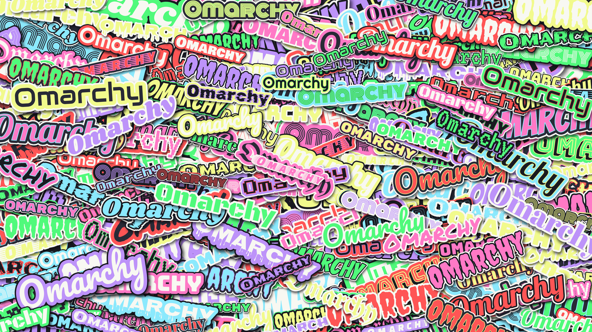

# StIcKeR bOmArChY

A dark [Omarchy](https://omarchy.org) theme in the classic
[Dracula](https://draculatheme.com) palette, with sticker-bomb "Omarchy"
wallpapers and window borders that sweep through every Dracula accent.



## Install

Open the Omarchy menu (`Super + Space`), choose **Install > Style > Theme**, and
paste:

```
https://github.com/hammwl55-creator/omarchy-sticker-bomarchy-theme
```

Or from a terminal:

```
omarchy theme install https://github.com/hammwl55-creator/omarchy-sticker-bomarchy-theme
```

## Wallpapers

- `1-sticker-bomb.png` (default): big, bold stickers with black keylines and neon
  edges, crowned by one full-size OMARCHY.
- `2-sticker-solo.png`: the plain Dracula background with one big green pixel
  sticker edged in pink, level and centered, for a subdued look.

Cycle between them with the Omarchy background switcher.

## Regenerating the wallpapers

`wallpaper-src/generate.py` draws them with ImageMagick 7. It needs the TTF
fonts in `wallpaper-src/fonts/`, which are not included here; it uses display
fonts from [Google Fonts](https://fonts.google.com) such as Bangers, Bungee,
Monoton, Pacifico and Press Start 2P.

```
python3 wallpaper-src/generate.py            # backgrounds/1-sticker-bomb.png
python3 wallpaper-src/generate.py solo       # backgrounds/2-sticker-solo.png
python3 wallpaper-src/generate.py quiet      # a sparse scatter (not shipped)
python3 wallpaper-src/generate.py bright     # the original dense, bright sticker bomb
python3 wallpaper-src/generate.py hero 42 out.png  # a different random layout
```

## Credits

Colors from the [Dracula](https://draculatheme.com) palette (MIT).
